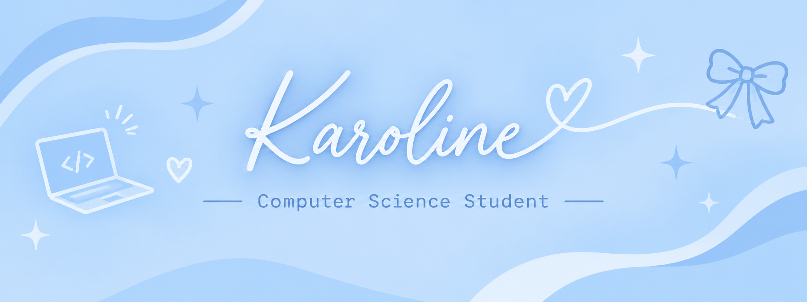

  

# Hey, I'm Karoline 🩵

**Computer Science Student · Aspiring Software Engineer**

---
## 💻 A Little About Me

I'm a Computer Science student taking my first steps into the world of technology.

I'm curious about how things work, passionate about learning, and excited to turn ideas into practical solutions.

I'm still discovering my strengths, exploring different areas of technology, and building the foundations of my journey towards becoming a Software Engineer.

## 🌱 What I'm Learning

- Programming fundamentals
- Problem-solving and logical thinking
- C programming
- Data Structures and Algorithms
- Git and GitHub

## ✨ My Goals

- Build projects of my own.
- Become more confident in programming.
- Strengthen my technical and problem-solving skills.
- Explore different areas of software development.
- Contribute to projects and learn from other developers.

## 🎀 Beyond the Code

A few things that make me, me:

- 📚 I love getting lost in a good novel.
- 🎧 Music is part of my everyday life.
- 💡 I love learning and exploring new ideas.
- 🩵 A creative mind with big ambitions.
- 🌷 A girl making her own space in tech. 

## 🛠️ Technologies & Tools

  

 

---

## 📂 Projects & Coursework

A collection of things I've worked on, experimented with and learned from along the way.

More projects coming soon! 🩵

---

*Learning, creating and becoming better with every step.*

